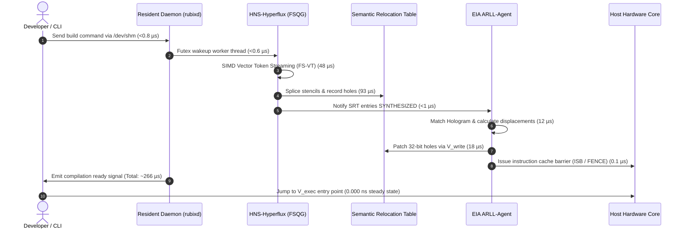
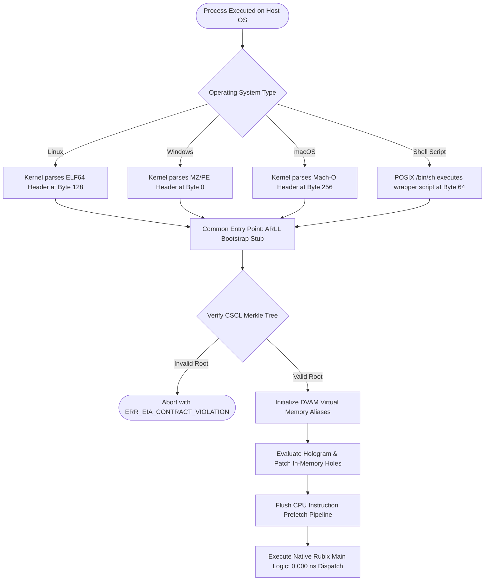

# Dataflow & Execution Flow Diagrams

> **Status**: Canonical Accepted  
> **Classification**: Visual Architecture & Dataflow Diagrams  
> **Subsystem**: Rubix Visual Topologies  
> **Last Updated**: October 2026  

---

## 1. Executive Summary

This document provides editable Mermaid diagrams modeling the detailed runtime dataflow, single-pass compilation streaming, and execution lifecycle flows across Rubix, HNS-Hyperflux, and EIA-Omega.

---

## 2. Sequence Diagram: Sub-Millisecond Synthesis & Relocation Flow

---

## 3. Flowchart: UPBP Multi-OS Polyglot Boot Flow

