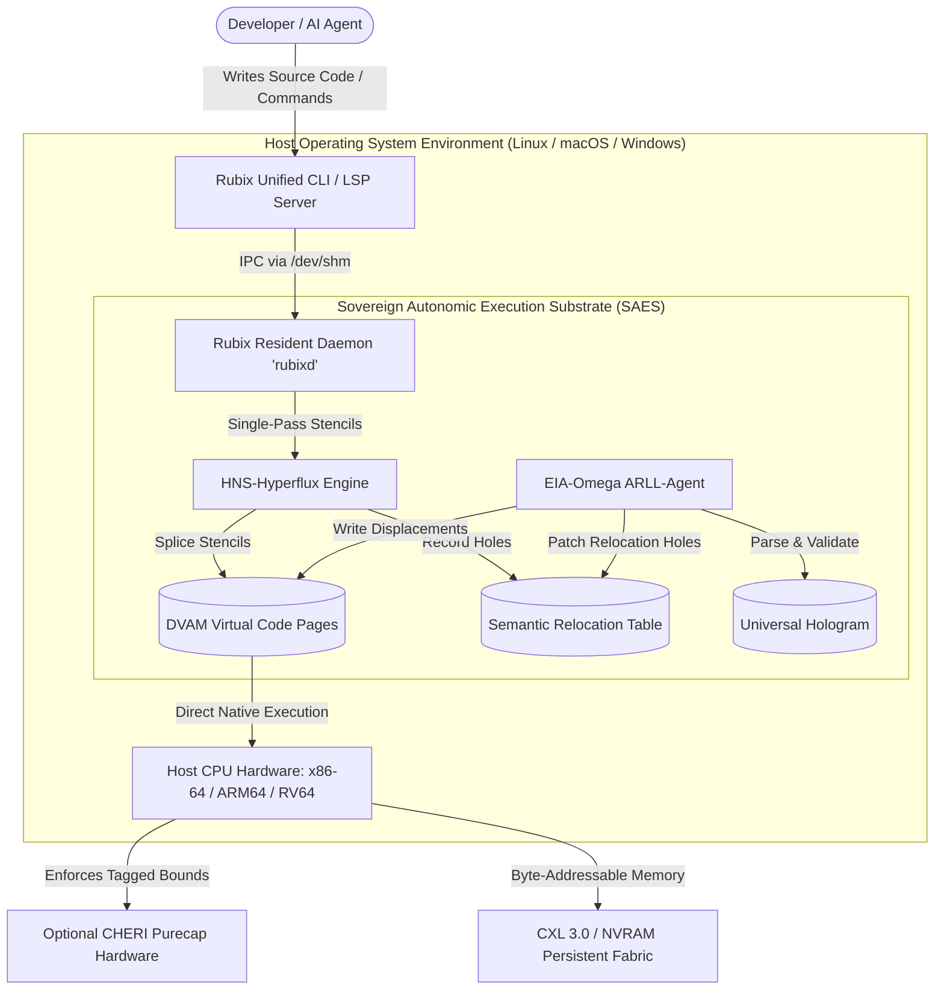
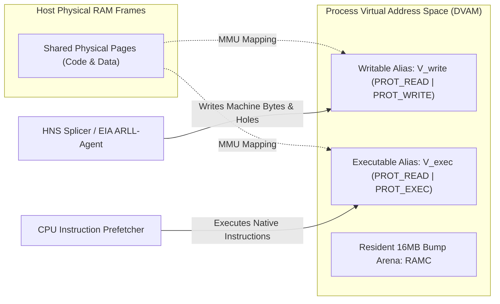

# System Context & Architecture Topology Diagrams

> **Status**: Canonical Accepted  
> **Classification**: Visual Architecture & C4 Topologies  
> **Subsystem**: Rubix Visual Topologies  
> **Last Updated**: October 2026  

---

## 1. Executive Summary

This document provides editable Mermaid architecture diagrams modeling the system context, component containers, and network/hardware topologies of the Rubix ecosystem, EIA-Omega, HNS-Hyperflux, and the Unified Substrate (SAES).

---

## 2. C4 Context Diagram: The Rubix Computing Ecosystem

---

## 3. Subsystem Container Diagram: In-Memory Memory Topology

