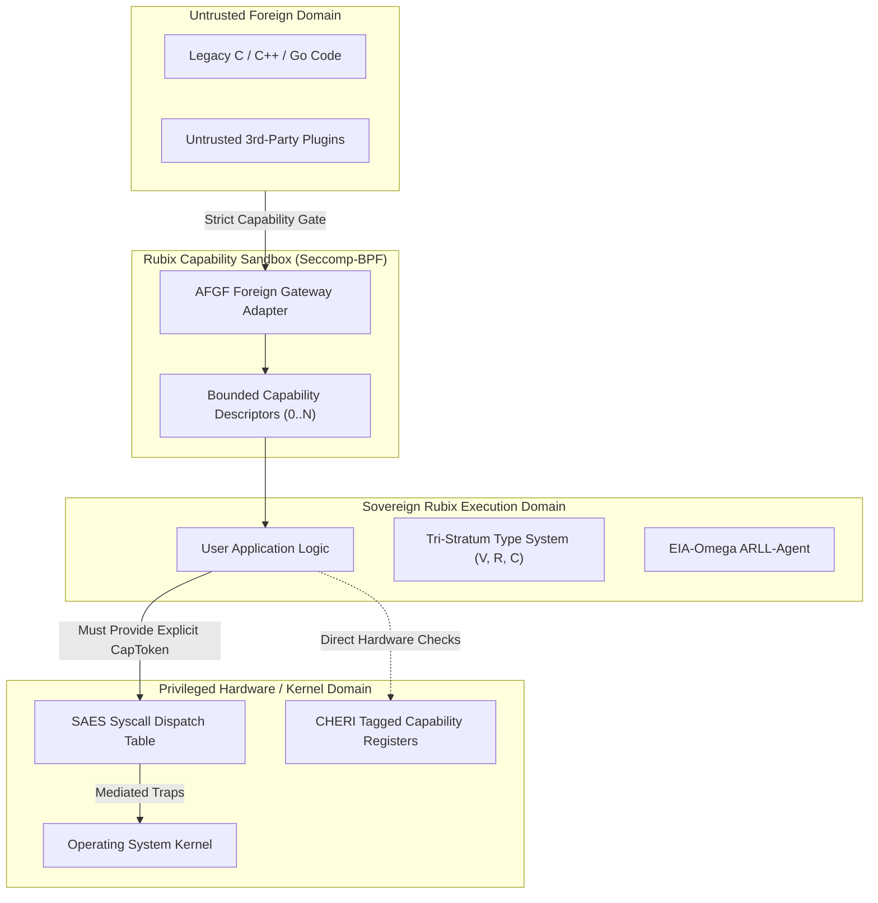
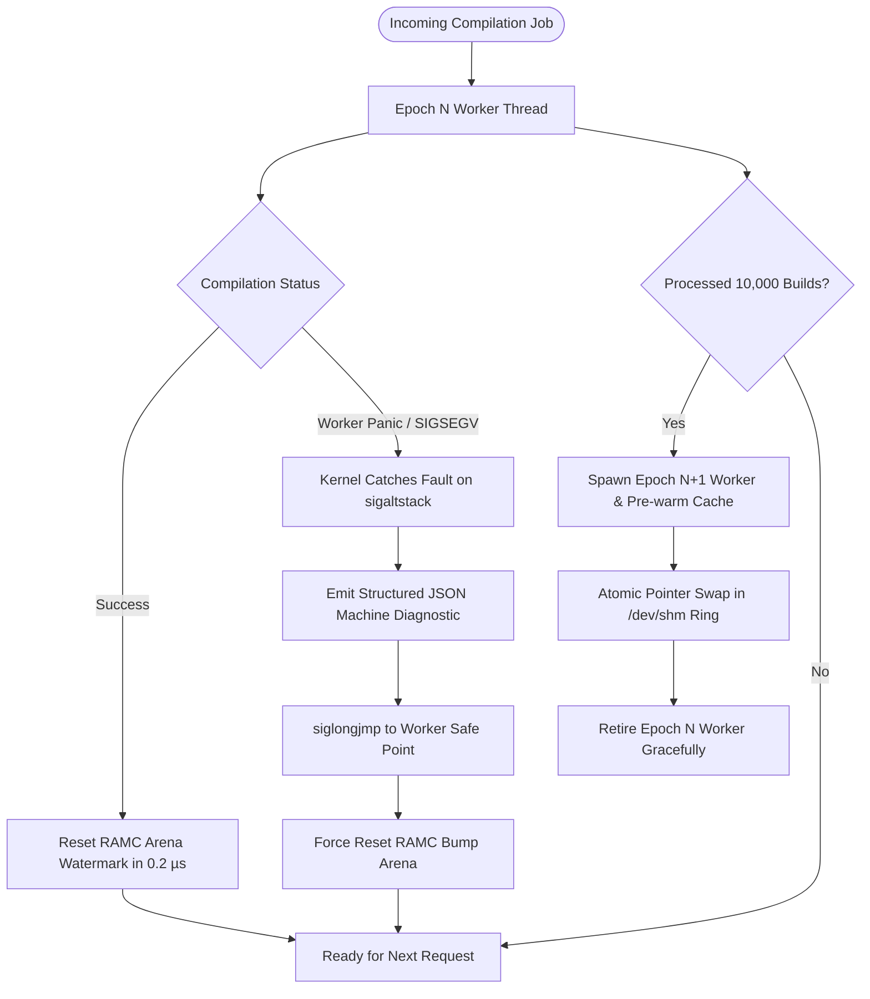

# Trust Boundaries & Failure Domain Diagrams

> **Status**: Canonical Accepted  
> **Classification**: Visual Architecture & Security Boundaries  
> **Subsystem**: Rubix Visual Topologies  
> **Last Updated**: October 2026  

---

## 1. Executive Summary

This document provides editable Mermaid diagrams modeling the trust domains, privilege isolation boundaries, and crash containment architectures within the Rubix ecosystem.

---

## 2. Security Trust Boundaries & Privilege Separation

---

## 3. Crash Isolation & Epoch Rejuvenation Flow

