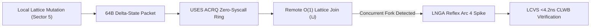

# Distributed Causal Fabric (DCF) Formal Specification (`SPEC-RUX-DCF-014`)

> **Subsystem Code:** `DCF`  
> **Spacetime Plate Allocation:** Sector 5 (`docs/rse.md`)  
> **LNGA Integration:** Reflex Arc 4 (`DCF -> LCVS` Causal Vitrification Trigger, `docs/lnga.md`)  
> **Latency Target:** `< 3.5 ns` local delta-join, `0` distributed lock round-trips

---

## 1. Architectural Thesis

Traditional distributed runtimes (Go, Erlang/BEAM, JVM/Akka, Rust/Raft) treat network replication as an external serialization-and-consensus layer bolted onto local mutable memory. Every replicated write pays JSON/Protobuf serialization overhead, TCP kernel buffer copies, and multi-RTT leader-election or two-phase-commit locks.

**Distributed Causal Fabric (DCF)** embeds mathematically convergent **State & Delta Join-Semilattices** directly into Sector 5 of the Rux Spacetime Plate (`RSE`):
- Every DCF state plate is a 64-byte cache-line-aligned hardware struct (`RXD`-compatible).
- Concurrent mutations on disjoint nodes never block and never coordinate locks.
- Replicas converge deterministically in $O(1)$ cache-line merges via bitwise/arithmetic least-upper-bound ($\sqcup$) instructions.

---

## 2. Algebraic Join-Semilattice Laws

A DCF state domain is a triple $(S, \sqcup, \bot)$ where $\bot \in S$ is the zero-initialized memory state and $\sqcup : S \times S \to S$ satisfies:

$$\forall x, y, z \in S: \quad (x \sqcup y) \sqcup z = x \sqcup (y \sqcup z) \quad \text{(Associativity)}$$

$$\forall x, y \in S: \quad x \sqcup y = y \sqcup x \quad \text{(Commutativity)}$$

$$\forall x \in S: \quad x \sqcup x = x \quad \text{(Idempotence)}$$

Because packet duplication (`a ⊔ a = a`), packet reordering (`a ⊔ b = b ⊔ a`), and arbitrary multi-hop batching (`(a ⊔ b) ⊔ c = a ⊔ (b ⊔ c)`) are algebraically invariant, DCF operates directly over raw `USES` `ACRQ` datagram/RDMA rings without sequence-number stalls.

---

## 3. Canonical Silicon Lattice Primitives

### 3.1 Causal Vector Clock (`DcfVectorClock64` — 64 Bytes)
Tracks causal happens-before ($e_1 \prec e_2$) across 8 sovereign cluster nodes in a single 64-byte CPU cache line:
- `epochs: [u64; 8]` — Monotonic per-node logical clocks.
- **Join ($V_a \sqcup V_b$):** Component-wise maximum $V'[i] = \max(V_a[i], V_b[i])$.
- **Concurrency Detection ($V_a \parallel V_b$):** True iff $\exists i, j : V_a[i] > V_b[i] \land V_b[j] > V_a[j]$. Triggers `LNGA` Reflex Arc 4 to vitrify a pre-merge `LCVS` checkpoint.

### 3.2 Monotonic Grow-Only & Positive-Negative Counters (`DcfPnCounter`)
- Splits increments `pos[node_id]` and decrements `neg[node_id]` across cache-aligned node slots.
- **Value Query:** $\sum_i \text{pos}[i] - \sum_i \text{neg}[i]$.
- **Join:** $\text{pos}'[i] = \max(\text{pos}_a[i], \text{pos}_b[i])$, $\text{neg}'[i] = \max(\text{neg}_a[i], \text{neg}_b[i])$.

### 3.3 Last-Writer-Wins Cryptographic Register (`DcfLwwRegister`)
- `value: u64`, `hlc_timestamp: u64` (Hybrid Logical Clock), `node_id: u64`, `blake3_tag: u64`.
- **Total Deterministic Tie-Break:** $R_a \sqcup R_b$ selects the higher `hlc_timestamp`; on exact timestamp collision, selects higher `(node_id, blake3_tag)`, guaranteeing 100% deterministic convergence across all replicas.

---

## 4. Hardware Synergy with `RSE`, `USES`, `LNGA`, and `LCVS`

