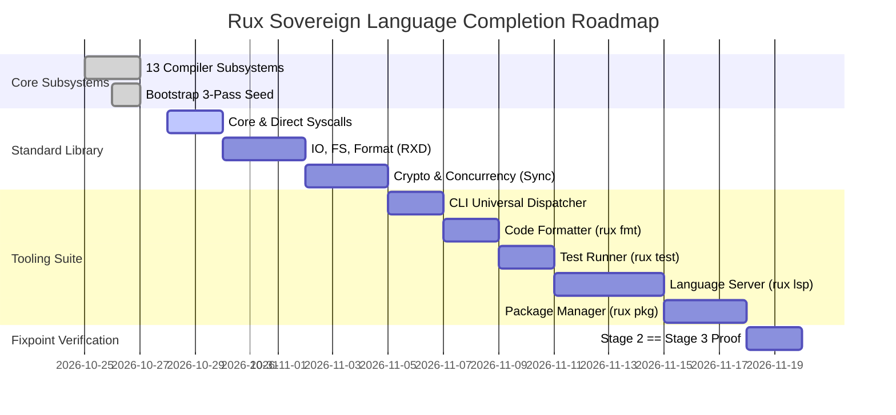

# Master Blueprint: The Complete Rux Language File System

This document establishes the sovereign file system architecture for the **entire Rux language ecosystem**, spanning the **Compiler**, **Standard Library**, **Tooling Suite**, **Bootstrap Seed**, **Test Harness**, and **User Project Layouts**, designed to surpass the developer ergonomics of Rust, Zig, Go, and C.

---

## 1. High-Level Ecosystem Topology

The Rux ecosystem is organized into six foundational pillars:

```text
rux/
├── compiler/     # The Sovereign Compiler Pipeline (ruxc + 12 Subsystems)
├── lib/          # The Sovereign Standard Library (pure .rx, zero libc)
├── tools/        # Developer Tooling Suite (fmt, lsp, test, doc, pm)
├── rsc/          # Resources, Bootstrap Seed & Project Templates
├── tests/        # Language & Subsystem Integration Test Suites
└── docs/         # Formal Specifications & Developer Manuals
```

---

## 2. Exhaustive Directory & File Plan

### 2.1 The Sovereign Standard Library (`rux/lib/`)
Written entirely in sovereign `.rx` with zero libc dependencies and direct silicon syscall bindings:

```text
rux/lib/
├── core/                  # Core Language Primitives & Memory Continuum
│   ├── types.rx           # Natural types (int, uint, byte, str, float, bool)
│   ├── memory.rx          # Monotonic bump arena & cacheline alignment
│   ├── slice.rx           # Fat pointer slice operations ({ ptr, len })
│   └── panic.rx           # Freestanding error trapping & stack unwind
│
├── io/                    # Zero-Allocation Input/Output Streams
│   ├── stream.rx          # Reader & Writer interface definitions
│   ├── print.rx           # Direct-syscall terminal printing routines
│   └── buffer.rx          # Ring-buffered I/O streams
│
├── fs/                    # Direct OS File System Navigation
│   ├── file.rx            # Open, read, write, close direct syscall wrappers
│   ├── path.rx            # Zero-copy path normalization and joining
│   └── dir.rx             # Directory traversal and entry iteration
│
├── format/                # Sovereign Rux Data (RXD) Engine
│   ├── rxd.rx             # .rxd unquoted text parser and AST builder
│   ├── rxdb.rx            # .rxdb zero-copy binary continuum serializer
│   └── shape_bind.rx      # Zero-cost deserialization into .rx shapes
│
├── crypto/                # Silicon Cryptographic Foundations
│   ├── blake3.rx          # High-throughput BLAKE3-64 and BLAKE3-256
│   ├── ed25519.rx         # Digital signatures and verification
│   └── merkle.rx          # Merkle tree synthesis for EIA Holograms
│
├── math/                  # High-Performance Numerical Computing
│   ├── scalar.rx          # Fast integer & floating point routines
│   ├── simd.rx            # AVX-512 / NEON vector types (f32x16, i64x8)
│   └── constants.rx       # High-precision mathematical constants
│
├── time/                  # Nanosecond Monotonic Timing
│   ├── clock.rx           # High-resolution monotonic timers via RDTSC
│   ├── duration.rx        # First-class duration types (5s, 500ms, 10ns)
│   └── sleep.rx           # Direct kernel nanosleep syscalls
│
├── sync/                  # Lock-Free Concurrency & Silicon Atomics
│   ├── atomic.rx          # Compare-and-swap, atomic loads and stores
│   ├── spinlock.rx        # Cacheline-friendly spinlock primitives
│   └── channel.rx         # SPSC lock-free circular ring queues
│
└── os/                    # Direct Operating System Syscall Table
    ├── linux_x86_64.rx    # Direct Linux x86_64 syscall numbers (no libc)
    ├── linux_arm64.rx     # Direct Linux AArch64 syscall numbers
    └── sys_types.rx       # Kernel struct layouts (stat, timespec, etc.)
```

---

### 2.2 The Developer Tooling Suite (`rux/tools/`)
The native toolchain shipping with the Rux distribution:

```text
rux/tools/
├── rux/                   # Universal CLI Dispatcher
│   └── main.rx            # Entrypoint routing commands: rux build, rux test, etc.
│
├── fmt/                   # Sovereign Code Formatter (`rux fmt`)
│   ├── rules.rx           # Idiomatic formatting rules (indentation, braces)
│   └── formatter.rx       # AST-based code rewriter for .rx and .rxd
│
├── test/                  # Test Runner & Benchmark Harness (`rux test`)
│   ├── harness.rx         # Discovery and execution of unit tests
│   └── bench.rx           # Nanosecond CPU cycle benchmarking via RDTSC
│
├── lsp/                   # Language Server Protocol (`rux lsp`)
│   ├── protocol.rx        # JSON-RPC / RXD protocol message handler
│   ├── completion.rx      # Contextual autocomplete engine
│   └── hover.rx           # Hover documentation and type inspection
│
├── doc/                   # Documentation Generator (`rux doc`)
│   ├── extractor.rx       # Docstring and comment extractor
│   └── markdown.rx        # Markdown / HTML manual site generator
│
└── pm/                    # Sovereign Package Manager (`rux pkg`)
    ├── manifest.rx        # Parser for rux.rxd project files
    ├── resolver.rx        # Topological dependency graph solver
    └── fetcher.rx         # Git / HTTP cryptographic tarball fetcher
```

---

### 2.3 The Sovereign Compiler Subsystems (`rux/compiler/`)
The 13 production compiler subsystems (already cleanly constructed):

```text
rux/compiler/
├── ruxc/                  # CLI Driver, Options & Pipeline Orchestrator
├── rux_rse/               # Rux Syntax Engine & 16MB Spacetime Plate
├── rux_ccns/              # Canonical Coordinates & Capability Enclaves
├── rux_lcvs/              # Lifetime Continuum & State Vitrification
├── rux_anss/              # Autonomic JIT Synthesis, Reflection & Const Fold
├── rux_zwns/              # Pre-Computed Machine Stencils (PCMSS) & Freestanding 174b ELF
├── rux_hsns/              # Hyper-Stride SIMD Streamer & Vector Swarm
├── rux_eia/               # Universal Hologram, Contracts & Displacement Relocations
├── rux_saes/              # Dual Virtual Alias Mapping (DVAM) & In-Memory Execution
├── rux_lnga/              # Lock-Free SpikeChannel & 5 Autonomic Reflex Arcs
├── rux_tspa/              # 4-Tier Persistent NVBox & Crash Recovery Ledger
├── rux_osla/              # Living Architecture & Direct Syscall Bridge
└── rux_uses/              # ACRQ Asynchronous Rings & In-Process Execution
```

---

### 2.4 Resources, Templates & Bootstrap Seed (`rux/rsc/`)
Everything required for cold-start bootstrapping and developer onboarding:

```text
rux/rsc/
├── bootstrap/             # 3-Pass Ken Thompson Self-Hosting Cold Seed
│   ├── memory/            # Cold-start linear memory allocator
│   ├── scanner/           # Cold-start token reader
│   ├── syntax/            # Cold-start recursive descent parser
│   ├── types/             # Cold-start type validator
│   ├── emitter/           # Cold-start machine code generator
│   ├── binary/            # Cold-start ELF64 writer
│   ├── verifier/          # 3-Pass fixpoint verification (Stage 2 == Stage 3)
│   ├── driver/            # Cold-start compiler driver
│   ├── boot_config.rxd    # Bootstrap configuration manifest
│   └── README.md          # Cold-start documentation
│
├── templates/             # Project Starter Templates
│   ├── cli_app/           # Standard command-line application template
│   ├── web_service/       # High-throughput zero-copy HTTP service
│   ├── embedded_bare/     # Freestanding 174-byte micro-kernel template
│   └── shared_lib/        # EIA Merkle-sealed dynamic library template
│
├── buildhelper/           # Architecture Target Triples & Syscall Tables
└── ci/                    # Automated Verification & Regression Workflows
```

---

### 2.5 Developer Project Structure (What a User's Project Looks Like)
When a developer runs `rux init my_app`, this clean structure is generated:

```text
my_app/
├── rux.rxd                # Sovereign project manifest (replaces Cargo.toml / package.json)
├── rux.lock.rxd           # Cryptographic BLAKE3 dependency lockfile
├── build.rx               # Sovereign build and compilation script
│
├── rsc/                   # Application Source Code (.rx only)
│   ├── main.rx            # Program entrypoint (fn main(args: []str) -> int)
│   ├── config.rxd         # Native application configuration
│   └── service.rx         # Business logic and domain shapes
│
└── tests/                 # Application Test Suite
    └── app_test.rx        # Integration tests run via `rux test`
```

#### Example `my_app/rux.rxd` Manifest:
```rxd
package {
    name: "my_app"
    version: "1.0.0"
    author: "Bishwa <dev@rux.org>"
    edition: 2026
}

target "my_app" {
    kind: "executable"
    entry: "rsc/main.rx"
    opt_level: "fast"
    memory_limit: 32MB
}

dependencies {
    http: "https://pkg.rux.org/http@2.1.0"
    crypto: "https://pkg.rux.org/crypto@1.4.0"
}
```

---

## 3. Directory Management Rules for Human Developers

1. **Strict File Size Limits**:
   - Every file must remain under **150–200 lines**.
   - If a file exceeds 180 lines, decompose it by sub-responsibility (e.g. `parser.rx` -> `expressions.rx`, `statements.rx`, `shapes.rx`).
2. **Explicit File Extensions**:
   - Code files MUST use **`.rx`** exclusively.
   - Configuration and data files MUST use **`.rxd`** (text) or **`.rxdb`** (binary continuum) exclusively.
   - Never use `.json`, `.toml`, or `.yaml` in sovereign Rux codebases.
3. **Plain English Naming**:
   - Use clear human programming words (`streamer.rx`, `allocator.rx`, `contracts.rx`).
   - Avoid cryptic abbreviations (`lex.rx`, `ast_p.rx`, `sym_t.rx`).
4. **Zero Circular Imports**:
   - Modules depend strictly downwards: `tools` -> `compiler` -> `lib/core` -> `@silicon`.

---

## 4. Execution Roadmap: Remaining Tasks for Rux



### Actionable Checklists:
- [x] **Pillar 1: Compiler Pipeline** (`rux/compiler/`): All 13 subsystems implemented with dedicated `.rx` files.
- [x] **Pillar 2: Bootstrap Harness** (`rux/rsc/bootstrap/`): 3-pass Ken Thompson verification seed complete (<160 lines/file).
- [ ] **Pillar 3: Standard Library** (`rux/lib/`): Populate `core/`, `io/`, `fs/`, `format/` (`rxd`), `crypto/`, `math/`, `time/`, `sync/`, `os/`.
- [ ] **Pillar 4: Developer Tooling** (`rux/tools/`): Implement `rux fmt`, `rux test`, `rux lsp`, `rux pm`.
- [ ] **Pillar 5: Project Templates** (`rux/rsc/templates/`): Provide starter templates for CLI, Web, and Freestanding apps.
- [ ] **Pillar 6: Fixpoint Gate Execution**: Run end-to-end 3-pass self-hosting cycle verifying bitwise binary identity.
